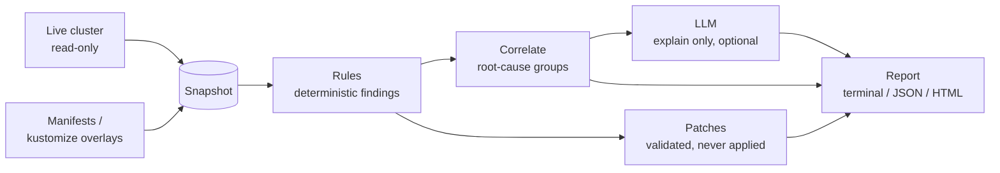

# k8s-doctor

[](https://github.com/rbalukja15/k8s-doctor/actions/workflows/ci.yml)
[](LICENSE)

**A read-only SRE health agent for Kubernetes clusters and manifests.** Deterministic rules find the problems, an optional LLM explains them in the context of your workload, and every suggested fix is validated before you see it. It never changes your cluster.

> Demo: coming with `make demo` (#23).

## The problem

Most Kubernetes incidents are not exotic. A Deployment with one replica gets drained. A container with no memory limit takes a node down. A `:latest` image means two pods of the same app run different code. A prod overlay quietly drops `runAsNonRoot` that dev still has.

Linters catch some of this, but they report symptoms one line at a time, they do not know which findings belong to the same root cause, and they cannot tell you whether dev and prod drifted apart. k8s-doctor is built for the platform or SRE engineer who has to answer "what is actually wrong with this workload, and what do I change?"

## How it works



- **Read-only, always.** The cluster collector only gets, lists and watches. Secret values are never read. Patches are files or diffs; nothing is applied.
- **Rules find, the LLM explains.** Every finding comes from a deterministic rule with a stable ID. The LLM can only explain findings that exist, which is checked mechanically, and the tool is fully useful with `--no-llm`.
- **Measured, not eyeballed.** Every rule ships with labeled positive, clean and near-miss fixtures, and detection precision/recall is published from `make eval`.

More detail: [architecture](docs/architecture.md), [CLI and JSON report](docs/cli.md), [rules](docs/rules.md), [ADR-0001: stack and scope](docs/adr/0001-stack-and-scope.md), [ADR-0002: snapshot and read-only guarantees](docs/adr/0002-collector-and-snapshot.md).

## Tech stack

Go, because the libraries this needs are Go libraries that can be called in-process: client-go for read-only cluster access, kustomize's `krusty` API for overlays, and kubeconform for validating patches. It ships as a single static binary. The full rationale is in [ADR-0001](docs/adr/0001-stack-and-scope.md).

## Usage

Early development: the rule engine, the first rules and the CLI work today on live clusters (read-only), manifest folders, kustomize overlays and snapshot files.

```console
$ go build -o bin/k8s-doctor ./cmd/k8s-doctor      # or: make build
$ bin/k8s-doctor rules
$ bin/k8s-doctor --cluster                               # current kubeconfig context, read-only
$ bin/k8s-doctor --manifests path/to/overlays/prod       # kustomize overlay, built in-process
$ bin/k8s-doctor --manifests path/to/manifests/          # plain YAML/JSON manifests
$ bin/k8s-doctor --snapshot fixtures/image-tag-mutable/positive/snapshot.json --explain
$ bin/k8s-doctor --snapshot fixtures/image-tag-mutable/positive/snapshot.json --format json
```

Findings print most severe first, and the exit code says how bad the worst one is (`--fail-on` sets the threshold, default `high`), so the tool can gate a CI job. See [docs/cli.md](docs/cli.md) for every flag, the exit codes and the JSON report schema.

## Development

```console
$ make help        # list targets
$ make test        # unit tests + the fixture suite
$ make lint        # golangci-lint, including gofumpt/goimports
$ make tools       # pinned kustomize and kubeconform into ./bin
$ make schemas     # Kubernetes JSON schemas for offline validation
$ make test-kind   # cluster collector against kind, as a read-only ServiceAccount
```

Install the hooks with `pre-commit install`. See [fixtures/README.md](fixtures/README.md) for adding rule fixtures.

## Roadmap

| Milestone | Scope |
|---|---|
| Foundations | Scaffold, CI, docs and ADRs, snapshot schema, rule engine, fixtures (#1–#6, #10, #15) |
| Collectors | Read-only cluster collector, manifest/kustomize collector, cross-mode tests (#7–#9) |
| Rules | Resources, probes, images, PDBs, securityContext, crashloops, scheduling, deprecated APIs (#11–#13) |
| Overlay drift | Match resources across overlays, field diff with allowlist, report section (#14, #28–#30) |
| LLM layer | Client, redaction, `--no-llm`, explanations, root-cause correlation (#26, #16, #17) |
| Fixes and reports | Validated patches, CLI + JSON report, HTML report (#18, #20, #19) |
| Eval and demo | Precision/recall harness, README table, kind demo cluster (#21–#23) |
| Release | Binaries and image, demo GIF, case study, v1.0 (#27, #25, #24) |

## License

[MIT](LICENSE)
