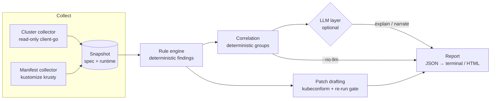

# Architecture

k8s-doctor is a pipeline with one deterministic core and an optional LLM layer on top.

## Stages

| Stage | Package | Issue | Status |
|---|---|---|---|
| Snapshot model | `internal/snapshot` | #6 | Done |
| Cluster collector | `internal/collector` | #7 | Planned |
| Manifest / kustomize collector | `internal/collector` | #8 | Planned |
| Rule engine, severity, finding IDs, config | `internal/rules`, `internal/config` | #10 | Done |
| Built-in rules | `internal/rules/checks` | #11, #12, #13 | Batch 1 done |
| Fixtures and runner | `fixtures/`, `internal/fixtures` | #15 | Done |
| Overlay drift | — | #14, #28–#30 | Planned |
| LLM client, redaction, `--no-llm` | `internal/llm` | #26 | Planned |
| Explain / correlate | `internal/llm` | #16, #17 | Planned |
| Patch drafting | — | #18 | Planned |
| JSON + terminal report, CLI | `internal/report`, `internal/cli` | #20 | Done |
| HTML report | `internal/report` | #19 | Planned |
| Eval | — | #21 | Planned |

## Key contracts

- **Snapshot** ([ADR-0002](adr/0002-collector-and-snapshot.md)): `spec` in both modes, `runtime` in cluster mode only. Secret values and env literals never enter it.
- **Rule** (`internal/rules/rule.go`): `ID`, `Category`, `Severity`, `Modes`, `Description`, `Evaluate`. Rules fill resource, field path, message and evidence; the engine stamps rule ID, severity and the stable finding ID.
- **Finding ID**: `KD-` + the first 16 hex characters of SHA-256 over rule ID, resource reference (`Kind/namespace/name`) and field path. Severity overrides and message wording do not change it.
- **Not run**: a rule that is disabled, needs another mode, or panics is listed with a reason rather than silently producing nothing.
- **Config** (`.k8s-doctor.yaml`): per-rule `enabled` and `severity`, plus the drift allowlist. Unknown keys and unknown rule IDs are errors.

See [ADR-0001](adr/0001-stack-and-scope.md) for the language choice, the read-only guarantee and the LLM data policy.
